# GastroBitácora — Laboratorio de Exploración y Comparación Culinaria

**GastroBitácora** es una aplicación web desarrollada con HTML5, CSS3 y JavaScript puro (Vanilla JS) que consume en tiempo de ejecución la API pública **TheMealDB**. La plataforma está diseñada para descubrir recetas al azar, realizar búsquedas avanzadas mediante la intersección de múltiples filtros simultáneos, inspeccionar fichas detalladas con ingredientes y pasos depurados, explorar categorías y cocinas del mundo, y comparar analíticamente la complejidad de dos platillos lado a lado.

---

## Integrantes y División del Trabajo

El desarrollo del proyecto se organizó de manera modular y colaborativa en Git, distribuyendo equitativamente la arquitectura de servicios, pseudocomponentes, vistas y coordinación de la aplicación:

* **Daniel Quintero:**
  * **Estructura y Recursos Base:** `index.html` (estructura semántica y carga ordenada de scripts) y `assets/ingrediente-default.svg` (recurso vectorial alternativo).
  * **Capa de Servicios y Datos:** `js/servicios/cache.js` (caché en memoria de sesión), `js/servicios/recetas.js` (normalización de ingredientes, limpieza de pasos y etiquetas) y `js/servicios/api.js` (cliente HTTP centralizado con manejo de errores).
  * **Pseudocomponentes:** `js/componentes/EstadoCarga.js`, `js/componentes/BarraNavegacion.js` y `js/componentes/TarjetaReceta.js`.
  * **Vistas:** `js/vistas/VistaInicio.js`, `js/vistas/VistaExplorar.js` y `js/vistas/VistaDetalle.js`.

* **Jean Villasmil:**
  * **Diseño Visual y Coordinación Global:** `css/styles.css` (identidad visual responsiva, *skeletons* y accesibilidad) y `js/app.js` (orquestador principal SPA, ciclo de vida de vistas, notificaciones y modales en el DOM).
  * **Capa de Lógica Matemática:** `js/servicios/comparacion.js` (cálculo de intersecciones, similitud porcentual y veredicto de sencillez).
  * **Pseudocomponentes:** `js/componentes/Paginador.js`, `js/componentes/FormularioBusqueda.js`, `js/componentes/ListaIngredientes.js`, `js/componentes/PasosPreparacion.js`, `js/componentes/PanelComparador.js` y `js/componentes/TablaComparacion.js`.
  * **Vistas:** `js/vistas/VistaCategoriasOrigenes.js` y `js/vistas/VistaComparador.js`.

---

## Instrucciones para Ejecutar el Proyecto

La aplicación no requiere servidores locales, compiladores ni instalación de dependencias externas.

1. Clonar el repositorio en tu equipo local:
   ```bash
   git clone https://github.com/DanielAlej12/Proyecto-2-Clientes-Web.git
   ```
2. Entrar a la carpeta raíz del proyecto y abrir directamente el archivo `index.html` en cualquier navegador web moderno (Chrome, Firefox, Edge o Safari).
3. Asegurarse de contar con conexión a internet para que la aplicación consulte los endpoints de **TheMealDB API** en tiempo de ejecución.

---

## Arquitectura de Pseudocomponentes y Eventos (`CustomEvent`)

Toda la interfaz está construida mediante clases propias en Vanilla JS con encapsulamiento de estado, renderizado seguro con `textContent`, manejo de eventos y método `destruir()` para limpieza del DOM. La comunicación entre componentes se realiza exclusivamente mediante eventos personalizados (`CustomEvent`):

| Pseudocomponente | Archivo | Responsabilidad | Eventos que emite (`CustomEvent`) |
| :--- | :--- | :--- | :--- |
| **`BarraNavegacion`** | `BarraNavegacion.js` | Renderiza la cabecera permanente, destaca la vista activa y actualiza el contador dinámico de recetas en el comparador (`0`, `1` o `2`). | `navegar-vista` (`detail: { vista }`) |
| **`TarjetaReceta`** | `TarjetaReceta.js` | Muestra la información resumida o completa de una receta, permite reintentar su carga individual si falló y ofrece acciones rápidas. | `abrir-detalle` (`detail: { id }`), `agregar-al-comparador` (`detail: { id, receta }`), `reintentar-detalle-tarjeta` (`detail: { id, tarjeta }`) |
| **`Paginador`** | `Paginador.js` | Gestiona la paginación en el cliente en bloques de 12 resultados por página con controles de avance y retroceso. | `cambio-pagina` (`detail: { pagina }`) |
| **`FormularioBusqueda`** | `FormularioBusqueda.js` | Captura y valida los 4 criterios combinables (nombre, categoría, origen, ingrediente) y despliega sugerencias autocompletadas mientras se escribe. | `ejecutar-busqueda` (`detail: { criterios }`), `limpiar-filtros` |
| **`ListaIngredientes`** | `ListaIngredientes.js` | Despliega la cuadrícula de ingredientes con miniatura, nombre y medida, sustituyendo la imagen por `ingrediente-default.svg` si ocurre un error de carga. | *(Presentacional; gestiona internamente el evento `error` de las imágenes)* |
| **`PasosPreparacion`** | `PasosPreparacion.js` | Presenta secuencialmente los pasos numerados tras filtrar encabezados redundantes de la API. | *(Presentacional)* |
| **`PanelComparador`** | `PanelComparador.js` | Administra de forma independiente los paneles A y B con buscador interno con *debounce* de 400 ms y cancelación mediante `AbortController`. | `seleccionar-receta-panel` (`detail: { idPanel, receta }`), `vaciar-panel-comparador` (`detail: { idPanel }`) |
| **`TablaComparacion`** | `TablaComparacion.js` | Muestra la tabla analítica lado a lado, resalta los valores numéricos menores, presenta similitud e ingredientes exclusivos y declara el veredicto de sencillez. | *(Presentacional)* |
| **`EstadoCarga`** | `EstadoCarga.js` | Renderiza indicadores *skeleton* con la forma del contenido que reemplazan (`heroe`, `tarjetas`, `detalle`, `panel`), estados vacíos y alertas de error. | `reintentar-accion` |

---

## Uso y Justificación de `Promise.all` vs `Promise.allSettled`

La aplicación selecciona cada método de coordinación asíncrona según la tolerancia a fallos requerida en cada flujo funcional:

### 1. Dónde se usó `Promise.allSettled` (Tolerancia a fallos parciales)
* **Vista de Inicio (`VistaInicio.js`):** Se solicitan en paralelo la receta destacada al azar (`random.php`) y el catálogo de categorías (`categories.php`). Se emplea `Promise.allSettled` para que, si una de las dos consultas falla por red o servidor, la otra sección se muestre con normalidad y únicamente la sección afectada presente su estado de error con opción de reintento independiente.
* **Resolución de detalles en tarjetas paginadas (`VistaExplorar.js` y `VistaCategoriasOrigenes.js`):** Dado que los endpoints de filtro (`filter.php`) devuelven únicamente datos resumidos, al renderizar una página de hasta 12 recetas se consulta su detalle completo (`lookup.php?i={id}`) en paralelo con `Promise.allSettled`. Si la petición de una receta individual falla, esa tarjeta se muestra con sus datos resumidos, se marca como incompleta y habilita un botón de reintento individual sin bloquear las otras 11 tarjetas de la página.
* **Recetas relacionadas en Detalle (`VistaDetalle.js`):** Las consultas paralelas para obtener hasta 6 recetas de la misma categoría y hasta 6 del mismo origen se coordinan con `Promise.allSettled`, asegurando que el fallo en la carga de un grupo no impida visualizar el otro.

### 2. Dónde se usó `Promise.all` (Dependencia total de respuestas)
* **Intersección de criterios en Exploración (`VistaExplorar.js`):** Cuando el usuario aplica múltiples criterios simultáneamente (por ejemplo: categoría + origen + ingrediente), se disparan todas las peticiones en paralelo con `Promise.all`. Se requiere obligatoriamente el éxito de la totalidad de las promesas para calcular matemáticamente la intersección exacta de recetas que cumplen todos los criterios al mismo tiempo.
* **Carga inicial de catálogos del formulario (`VistaExplorar.js`):** Las listas de categorías (`categories.php`), orígenes (`list.php?a=list`) e ingredientes (`list.php?i=list`) se obtienen en paralelo con `Promise.all` para construir íntegramente los selectores y el autocompletado del formulario de filtros antes de habilitar la búsqueda.

---

## Decisiones de Diseño

* **Identidad Visual y Paleta de Colores:** Inspirada en bitácoras gastronómicas artesanales y especias cálidas, priorizando el contraste y la legibilidad prolongada:
  * **Fondo principal (`#FAF6F0`):** Crema pergamino cálido que evita la fatiga visual frente al blanco puro.
  * **Superficies (`#FFFFFF` y `#F3ECE1`):** Tarjetas y paneles elevados con bordes suaves (`#DFD3C3`).
  * **Color primario (`#C85A32`):** Terracota especiado para llamadas a la acción principales, pestañas activas e indicadores de navegación.
  * **Color secundario (`#2D6A4F`):** Verde salvia culinario empleado en etiquetas de origen, el veredicto de receta más sencilla y el resaltado de valores menores en la tabla comparativa.
  * **Texto principal (`#241C15`):** Carbón cacao oscuro de alto contraste.
* **Tipografía:** Combinación editorial entre `Georgia` (serif) para los títulos de los platillos y encabezados de sección, y `system-ui` / `Segoe UI` (sans-serif) para controles interactivos, tablas de métricas y lectura ágil de ingredientes y pasos.
* **Iconografía y Recursos Alternativos:** Uso de píldoras semánticas diferenciadas por color para categorías y orígenes, insignias circulares numeradas para los pasos de preparación y un ícono vectorial propio (`assets/ingrediente-default.svg`) diseñado con la misma paleta cromática para sustituir imágenes rotas de ingredientes.
* **Experiencia de Usuario y Accesibilidad:** Implementación de esqueletos de carga (*skeletons*) animados con las proporciones exactas de cada bloque de contenido, diseño responsivo con CSS Grid y Flexbox sin desbordamiento horizontal en móviles, y estados `:hover` y `:focus-visible` de alto contraste para navegación completa por teclado.

---

## Capturas de Pantalla

### 1. Vista de Inicio (Receta destacada al azar y cuadrícula de categorías)
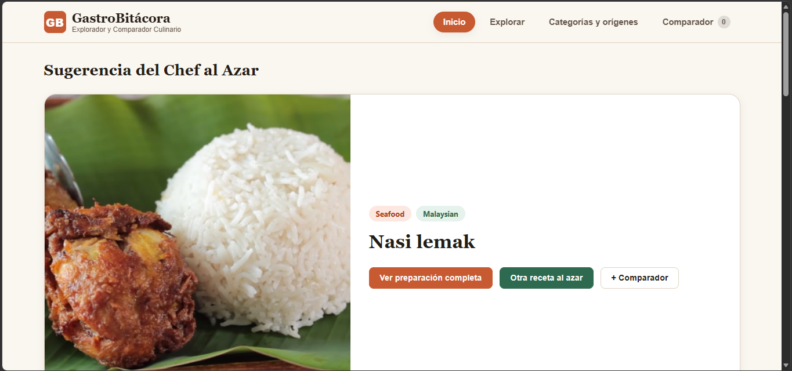
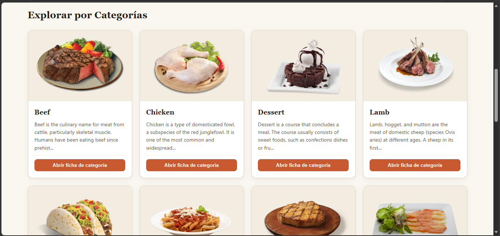

### 2. Vista Explorar (Filtros combinados, autocompletado y paginación)
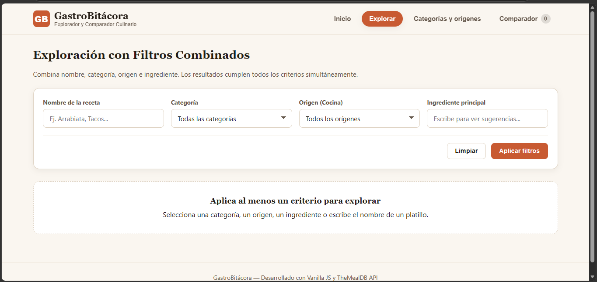
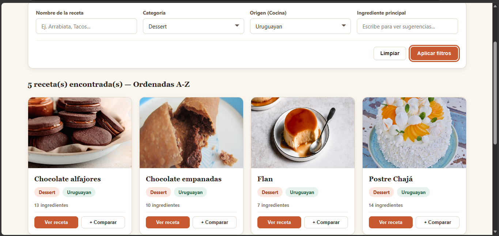

### 3. Vista de Detalle (Ingredientes, pasos numerados y recetas relacionadas)
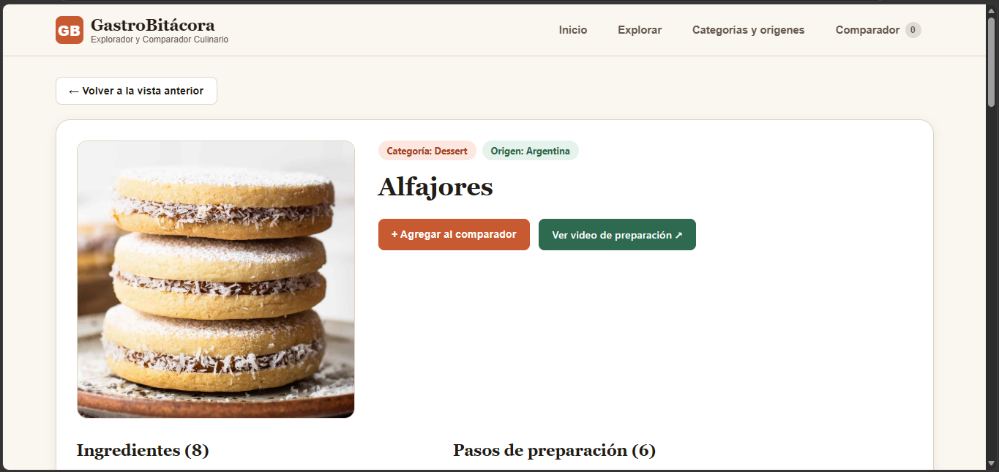
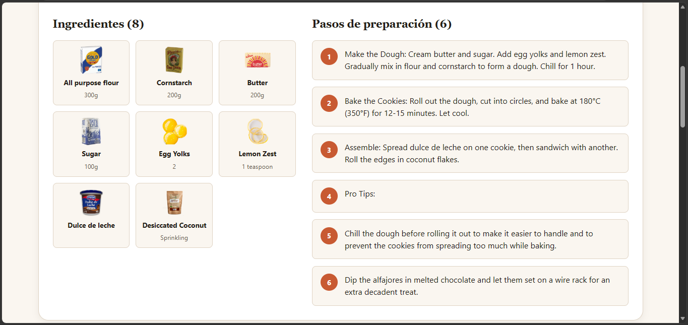
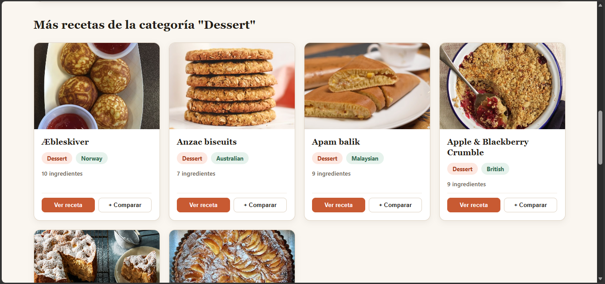

### 4. Vista de Categorías y Orígenes (Pestañas y ficha descriptiva)
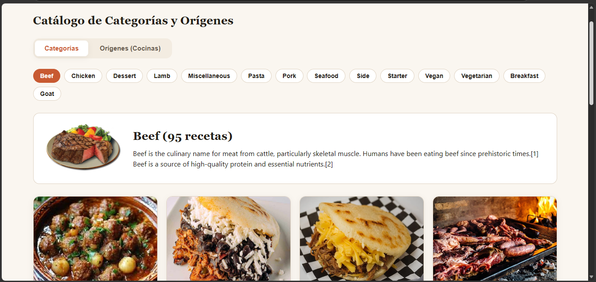
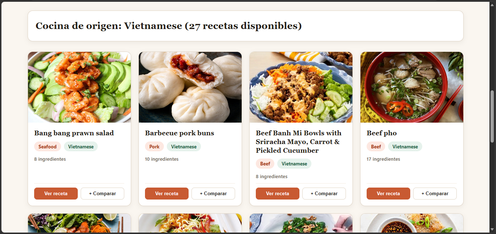

### 5. Vista Comparador (Paneles A/B, tabla de métricas y veredicto)
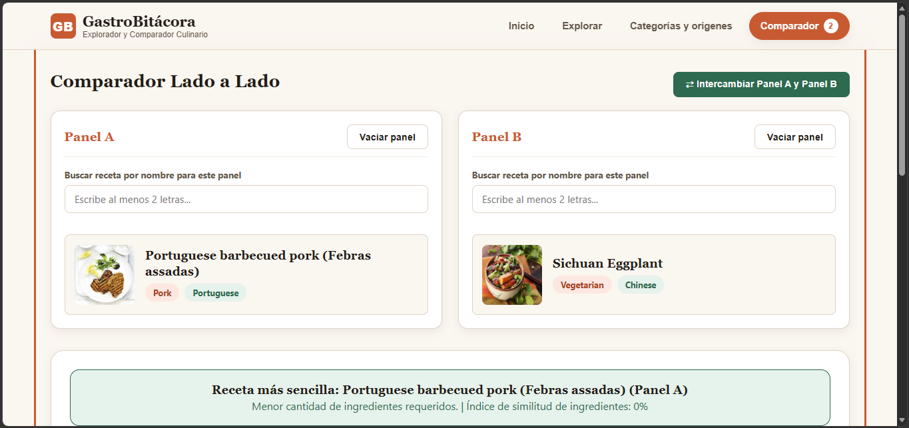
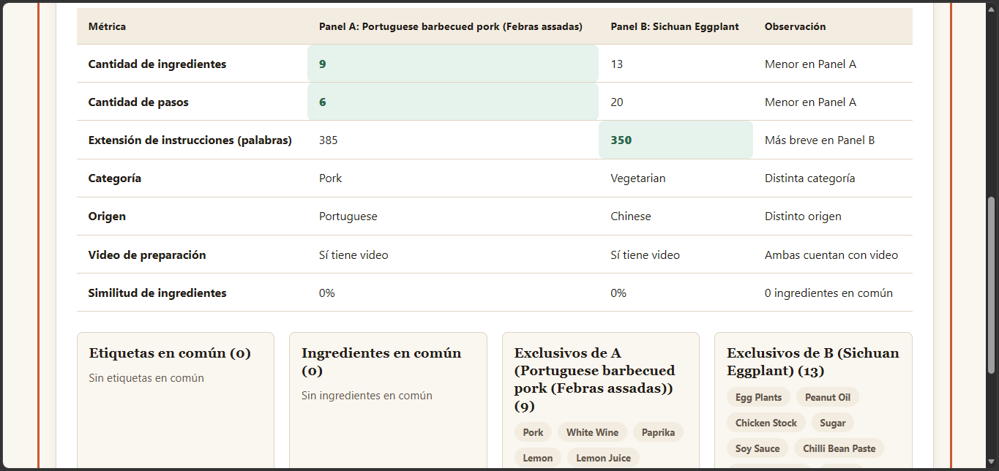
